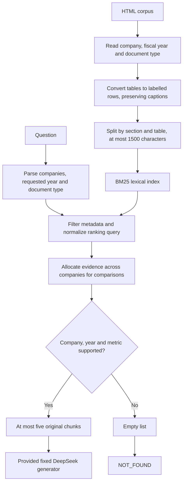

# FTEC5660 Homework 4

A lexical retrieval system for the provided company-report corpus. The five required functions are implemented in `hw4.py`; the supplied generator, runner and scoring code are unchanged. No embedding model or retrieval LLM is used.

## Reproduce

Use Python 3.10 or later (tested with Python 3.12).

```bash
python3 -m venv .venv
source .venv/bin/activate
pip install -r requirements.txt
cp .env.example .env
# Set DEEPSEEK_API_KEY in .env locally.
python verify.py
python hw4.py --data-folder public_test --output results.csv
python ablation.py --data-folder public_test
```

`verify.py` runs offline. The official runner and the full ablation call the provided DeepSeek generator and require a working key. `python ablation.py --offline --output ablation_offline` measures retrieval only and leaves answer accuracy unmeasured. Do not mix these outputs with the full experiment. Each full ablation variant rebuilds its index and generates fresh answers; the script stops on API errors. No answer cache or ground-truth-driven retrieval is used.

`.env`, virtual environments and serialized indexes are ignored by Git. `public_test/ground_truth.json`, `docs.json` and `tables.json` are used by evaluation only; production retrieval does not read them. The company vocabulary is derived from the supplied HTML and rebuilt in memory. No company names, file names, questions or answers are hard-coded in the implementation.

## Homework 4 solution

### Pipeline



The parser reads the subject company from the document's `h1` and the review year/document type from the opening text, so a broker is not mistaken for its research subject. Every table row retains its label and column headers, and captions preserve units. Section-aware splitting preserves original text with a short section/caption header, 100-character overlap and a strict 1,500-character limit. BM25 uses regex tokens, stop-word removal and a small set of lexical aliases. Query parsing preserves unknown company names rather than resolving them to a similar known company. Metadata filters select the subject and document type: an annual report from year Y or Y+1 may support a fact about year Y, including prior-year table columns. Ranking then removes the already-filtered company and year terms to focus on the requested metric. Comparisons receive chunks in round-robin company order. Abstention rejects unknown entities, missing eligible documents and annual-report questions whose material metric terms are absent from each company's eligible documents. The output consists solely of original chunks; no answers are inserted into retrieved text.

### Experimental design and results

All variants use the same 40 documents and 60 public questions: 46 answerable questions and 14 unanswerable questions. Recall@5 and kept rate use the 46 answerable questions; rejected rate uses the 14 unanswerable questions; answer accuracy uses all 60. The generator is the unchanged `deepseek-v4-flash` at temperature zero. B0 follows the required baseline: BeautifulSoup `get_text()`, `RecursiveCharacterTextSplitter`, required metadata, lowercase whitespace BM25, global top-five retrieval and no abstention. Each subsequent row changes one component of the previous configuration. In particular, metadata filtering and removal of entity/year tokens from the ranking query are separate experiments.

| Variant | Change | Recall@5 | Kept | Rejected | Accuracy | Retrieval s |
|---|---|---:|---:|---:|---:|---:|
| B0 | Naive get_text + recursive split + whitespace BM25 | 28.3% | 100.0% | 0.0% | 50.0% | 0.137 |
| V1 | Replace HTML tables with labelled table text | 28.3% | 100.0% | 0.0% | 45.0% | 0.275 |
| V2 | Use section-aware chunks with section/caption headers | 28.3% | 100.0% | 0.0% | 41.7% | 0.311 |
| V3 | Use regex tokens, stop words and lexical aliases | 19.6% | 100.0% | 0.0% | 36.7% | 0.298 |
| V4 | Parse queries and filter company/year/document metadata | 63.0% | 100.0% | 71.4% | 73.3% | 0.392 |
| V5 | Remove company/year terms from the ranking query | 100.0% | 100.0% | 71.4% | 100.0% | 0.38 |
| V6 | Allocate comparison evidence per company | 100.0% | 100.0% | 71.4% | 100.0% | 0.386 |
| V7 | Reject unknown companies, unsupported years/metrics | 100.0% | 100.0% | 100.0% | 100.0% | 0.425 |

Measured results are in `ablation_results/*_results.csv`; `summary.json` contains exact rates and times, and `usage.json` contains token usage. `results.csv` is the separate official-runner output for the final system. The public set was used for development, so these results are not an unbiased estimate of private-set performance. No private-set performance is claimed.

V1 preserves the column-value relationship but does not improve recall (28.3%); accuracy changes from 50.0% to 45.0%. Better serialization alone cannot recover missing evidence, and it changes both chunk boundaries and the generator context. V2 also leaves recall at 28.3%, while accuracy changes to 41.7%. The finer sections produce 865 chunks instead of 294, increasing competition among short passages that repeat company names. V3 reaches 19.6% recall and 36.7% accuracy; more consistent tokenization is not sufficient when irrelevant entity terms still dominate global retrieval. Negative results are retained rather than omitted.

V4 raises recall to 63.0% and accuracy to 73.3% by selecting eligible subjects, years and document types. It also rejects 10 of 14 unanswerable questions naturally because their filters have no matching documents. V5 raises recall to 100.0% by removing company/year terms already handled by metadata, letting metric words determine ranking. Answer accuracy reaches 100.0%. V6 has 100.0% recall and 100.0% accuracy: round-robin allocation is an explicit coverage safeguard, but it provides no additional recall gain on this public set. V7 increases retrieval-level rejection from 71.4% to 100.0%, with a kept rate of 100.0%. This avoids four unnecessary generator calls and improves Task 3's separate retrieval-level criterion. End-to-end accuracy and retriever rejection are distinct: a generator can still answer NOT_FOUND after receiving irrelevant passages.

This is a cumulative ablation, so each difference is conditional on the preceding components; it does not isolate every interaction or prove that each component is necessary in the final system. The generator can vary between runs despite temperature zero. The table records one complete measured run, not confidence intervals or cherry-picked best scores. This verified run was generated into a separate output directory to avoid mixing results from overlapping runs. The eight configurations used 436 generator calls, 586,951 input tokens and 1,375 output tokens; the supplied usage tracker estimates USD 0.0889 using the assignment's price constants.

### Error analysis and limitations

B0's q001 asks about the absent Northgate Robotic Systems. The generator answers `241.6`; the expected answer is `NOT_FOUND`. Its selected sources are `doc_028.html;doc_038.html`. The baseline can retrieve similarly named companies because it has no entity filter. The final retriever explicitly rejects unknown entities before generation.

V4's q002 asks for Brightwater Software's FY2025 revenue. Its recorded answer is `1600`, versus the exact expected value `1574.7`, with sources `doc_020.html`. Even after choosing the right company's report, selecting a rounded narrative passage instead of the exact table can fail the numerical tolerance. V5 focuses ranking on the metric rather than repeated entity/year terms. These cases distinguish source selection, passage selection and generator accuracy.

The final public run has no observed errors, but that does not establish general robustness. The regex entity parser may fail on unfamiliar grammar, lowercase unseen names, unusual punctuation or more complex comparison syntax. The HTML parser assumes the assignment's document structure and ordinary single-row table headers; it does not expand arbitrary merged-cell spreadsheets. Annual-report year eligibility follows the assignment's two-column design. Nonannual eligibility uses a broad relative-year window; a future extension should explicitly distinguish actuals, guidance and forecast horizons. Metric-term coverage is a lexical answerability heuristic: vocabulary appearing somewhere in a document does not prove that the requested number is disclosed, and an unseen synonym can cause a false rejection. The research/call path does not apply that metric coverage check. More diverse held-out questions would be needed before deployment; public-set perfection should not justify tuning against hidden answers.

### Validation

The public table-cell checks pass for all 12 table types, and all 40 documents pass metadata, chunk-size and probe-preservation checks. The official public runner reports 100% valid nonempty retrieval on answerable questions, 100% query-field accuracy, 100% recall@5, 100% kept and rejected rates, and 100% answer accuracy (75/75 estimated points for Tasks 1-4 only). These are public-set estimates, not the final course grade. `verify.py` additionally checks that retrieved objects belong to the original chunk list and tests renamed/unknown entities. The final files also passed the offline verifier and official runner from a fresh local checkout, reusing the installed Python environment but rebuilding the index from the corpus. The provided-code suffix is checked against the starter version to ensure that the generator and scoring have not been modified.

## Task 6: Reflection

*AI-assisted draft for personal review. It states aspirations rather than inventing personal experiences; I would revise it to reflect my own priorities before submission.*

Ten years from now, if powerful personal AI agents can write, program, research and manage businesses, I would want to be someone who can be trusted with their power. I do not want my identity to depend on being the fastest person to produce a report or solve a technical problem. I want to choose worthwhile problems, understand the people affected by my decisions, and take responsibility when the tools I use are wrong.

My ambition to learn and to build useful things would still matter. In business and finance, a technically successful system can still serve a harmful objective or distribute its benefits unfairly. I would therefore care less about proving that I can outperform a machine and more about understanding what a project is for. Financial independence and professional competence would remain valuable because they create room to make deliberate choices, not because they settle the question of my worth.

Beyond productivity, I would want to be known for honesty, reliability and care. When a friend needs attention, an efficient response is not always the right response. When a team makes a mistake, I would want to be the person who admits uncertainty and helps repair the damage. An agent may help me write a thoughtful message, but I still have to mean it and act consistently with it.

I would still be willing to struggle with understanding, relationships and commitments. There is a difference between obtaining a correct explanation and developing the judgment to notice when an explanation is wrong. I would use AI to get feedback while sometimes working through an argument or a piece of code myself. I would also keep doing difficult things whose value lies partly in participation: listening during a disagreement, practising a skill, and showing up when helping someone is inconvenient. Avoiding every difficulty would also remove opportunities to develop patience and courage.

The qualities that would make me valuable include judgment, intellectual humility, empathy and the ability to connect technical choices to real consequences. Domain knowledge would still matter: without it, I could mistake fluent output for evidence. Collaboration would matter because people must decide together what they are willing to accept. These qualities are not valuable only because machines might lack them; they shape the kind of life and community I want to help create.

If my value is no longer determined primarily by what I can do, I would define myself through what I consistently choose to care about and take responsibility for. That definition cannot depend entirely on recognition or economic demand. My commitments to people, my willingness to tell the truth, and my treatment of those who cannot reward me would be stronger measures than a productivity ranking.

Tomorrow, I can start with three small changes: reserve some time to learn without immediately outsourcing the difficult step; verify one important AI-generated claim instead of accepting it because it sounds convincing; and give someone my full attention without turning the interaction into a task to optimize. I can also record why I made a consequential decision, including what I did not know. The point is not to use less AI for its own sake. It is to practise being accountable while using increasingly capable tools.

## Submission checklist

- Review the reflection so it represents your own views.
- Keep the repository named `FTEC5660-HW4` public during grading.
- Include `hw4.py`, `requirements.txt`, `ablation.py`, this README and measured result CSVs.
- Never upload `.env`, `.venv`, API keys or serialized indexes.
- Submit your own public GitHub fork link on Blackboard before the assignment deadline.

The local files do not themselves create a GitHub fork or submit anything to Blackboard.
